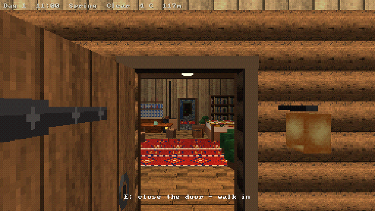
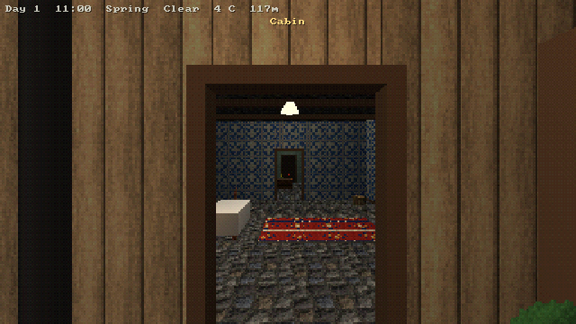
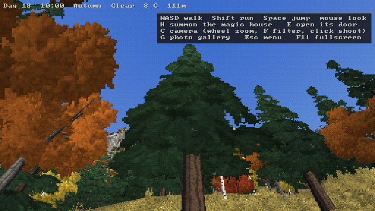
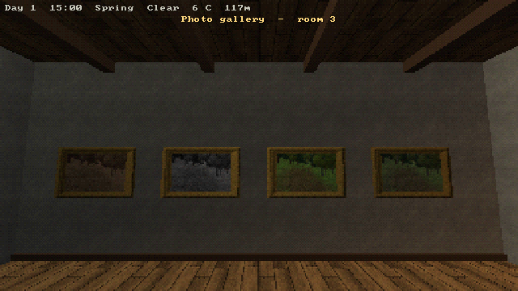

# Mountain

A relaxing retro 3D game about hiking on a mountain. Every world is a new,
randomly generated mountain with forests, meadows, lakes, a marked trail to the
summit, days and nights, a moon with real phases, stars, four seasons, changing
weather, plants and calm wildlife. Take photos of the views, and summon a
magic house that always looks as if it had been there forever, with an endless
chain of cozy rooms inside, each with a big window onto the mountain.

**Play in the browser:** <https://makesgamessteve-hash.github.io/mountain/>
(desktop, phones and tablets with touch controls, and VR headsets via WebXR).

| | |
|---|---|
|  |  |
|  |  |

## Features

- **Random mountains**: seeded terrain with a main peak, surrounding ranges,
  hydraulic erosion, lakes, biomes by altitude and slope, a hiking trail with
  cairns from the trailhead to the summit, and detected scenic viewpoints.
- **Sky and time**: sun path by latitude and season, moon(s) with correctly lit
  phases, stars and the milky way, sunsets, a cloud layer. Planets are data:
  more moons or another sky are a script change away.
- **Seasons and weather**: foliage colours, bare trees, blossoms, flowers,
  snow lines and fresh snow; clear, cloudy, overcast, fog, rain, storms with
  lightning and thunder, snow.
- **Flora and fauna**: script-defined species; 3D trunks with sprite leaf
  clusters and distance LOD, dense grass and flowers near you; deer, ibex,
  marmots, foxes, hares, songbirds, an eagle, butterflies and fireflies that
  keep their distance but are never hostile.
- **The magic house**: summon it with `H`. It settles into the site as a
  cottage, a house built into the hillside, a tree house or a house on stilts
  by a lake. Open the door with `E` and you can see inside; walk in to a cozy
  wood cabin with a huge bed, kitchen, writer's desk, bookshelf and fireplace.
  A door at the back of every room leads to another (library, greenhouse,
  observatory, tea room, bath, music room, a gallery with your latest photos),
  forever. Every room has a big window with a view of the mountain. Send the
  house away with `H` from outside.
- **Photography**: camera mode with zoom and filters, photos saved as PNG,
  an in-game gallery, browser downloads on the web.
- **Retro look**: low internal resolution (180-360 lines), nearest-neighbour
  upscaling, ordered dithering and a mix of 3D meshes, voxels and sprites.

## Controls

| Action | Keyboard / mouse | Gamepad | Touch | VR (WebXR) |
|---|---|---|---|---|
| Walk / look | WASD or arrows / mouse (click to capture) | left / right stick | left half: stick, right half: drag | left stick, head |
| Run | Shift | click left stick | push the stick fully | grip |
| Jump | Space | A | jump button | A |
| Open door | E | X | hand button | trigger |
| Magic house | H | Y | house button | Y |
| Camera | C, then click/Enter to shoot, wheel zoom, F filter | RB, RT shoots, D-pad zoom/filter, B leaves | camera button | B takes a photo |
| Gallery | G | Back | gallery button | |
| Menu | Esc | Start | menu button | X |
| Snap turn | | | | right stick |

`F11` fullscreen, `F3` debug info, `F5` reload the scripts.

## Building

The engine is C17 with SDL3 and OpenGL 3.3 (OpenGL ES 3.0 / WebGL2 on the
web). Lua 5.4 and stb are vendored in `third_party/`. SDL3 is used from your
system if CMake finds it, otherwise it is downloaded and built automatically.

### Linux

```bash
sudo apt install build-essential cmake ninja-build libx11-dev libxext-dev libxrandr-dev libxcursor-dev libxi-dev libxss-dev libxkbcommon-dev libgl-dev libasound2-dev libpulse-dev
```

```bash
cmake -S . -B build -G Ninja -DCMAKE_BUILD_TYPE=Release
```

```bash
cmake --build build && ./build/bin/mountain
```

### Windows

With Visual Studio 2022 (or a MinGW cross compiler, see `cmake/mingw-w64-x86_64.cmake`):

```bash
cmake -S . -B build -G "Visual Studio 17 2022" -A x64
```

```bash
cmake --build build --config Release
```

Run `build/bin/mountain.exe`; the `assets` folder is copied next to it.

### Web (Emscripten, WebXR)

```bash
emcmake cmake -S . -B build/web -DCMAKE_BUILD_TYPE=Release
```

```bash
cmake --build build/web
```

Serve `build/web/bin/` with any static web server and open `mountain.html`.
The assets are packaged in `mountain.data` next to the WebAssembly binary.
Phones and tablets get touch controls automatically (and on the first touch);
browsers with WebXR show an **Enter VR** button.

The `gh-pages` branch contains only the latest web build from `main` (CI
publishes it). To serve it, enable **Settings → Pages → Deploy from a branch →
`gh-pages` / root** once in the GitHub repository.

## Modding and scripting

Nothing is baked into the executable: `assets/` beside the binary holds the
Lua scripts, GLSL shaders, textures, sounds and the font. A `mods/` folder
beside the binary overrides any file with the same relative path.

- `assets/scripts/main.lua`: entry point (`init`, `update`, `action`, `draw`)
- `assets/scripts/content/earth.lua`: the planet, plant and animal species
- `assets/scripts/content/rooms.lua`: the rooms of the magic house
- `assets/scripts/hud.lua`, `ambience.lua`: interface and soundscape

The complete script API is documented in [docs/script-api.md](docs/script-api.md).
Textures and sounds are generated reproducibly by `tools/gen_assets.py`.

## Tests

- **Unit tests** (`tests/unit/`) cover the engine core and the Lua API.
- **Automated game tests** (`tests/game/*.lua`) run the real game headless
  (Xvfb + Mesa software OpenGL, dummy audio) and inject real SDL keyboard,
  mouse, touch and gamepad events: walking, the house and its rooms, photos,
  the gallery, the menu, weather, seasons and time of day.
- **Coverage gate**: `tools/coverage.sh` builds with coverage, runs both
  suites and fails below 95% line coverage of `engine/` (`third_party/` excluded).
- **Web smoke test**: `node tests/web/smoke.cjs build/web/bin` loads the web
  build in headless Chromium (desktop, emulated phone with touch, mocked WebXR).

```bash
tools/coverage.sh build/coverage 95
```

## Specifications

The project uses [OpenSpec](https://github.com/Fission-AI/OpenSpec):
capability specs live in `openspec/specs/`, proposed changes in
`openspec/changes/`. Validate with `npx @fission-ai/openspec validate --all --strict`.

## License

- Code (engine, scripts, shaders, tools): [MIT](LICENSE)
- Art and sounds (`assets/textures`, `assets/sounds`, screenshots in `docs/images`):
  [CC BY 4.0](assets/LICENSE.md)
- Third party: Lua (MIT), stb (MIT / public domain), font8x8 (public domain), SDL3 (zlib)
